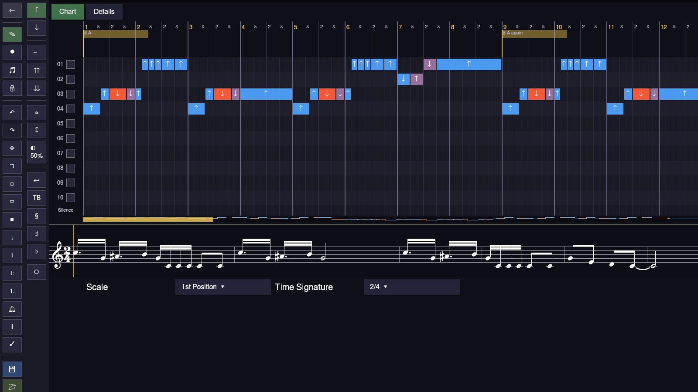
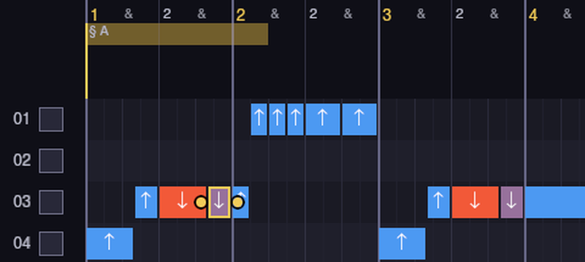
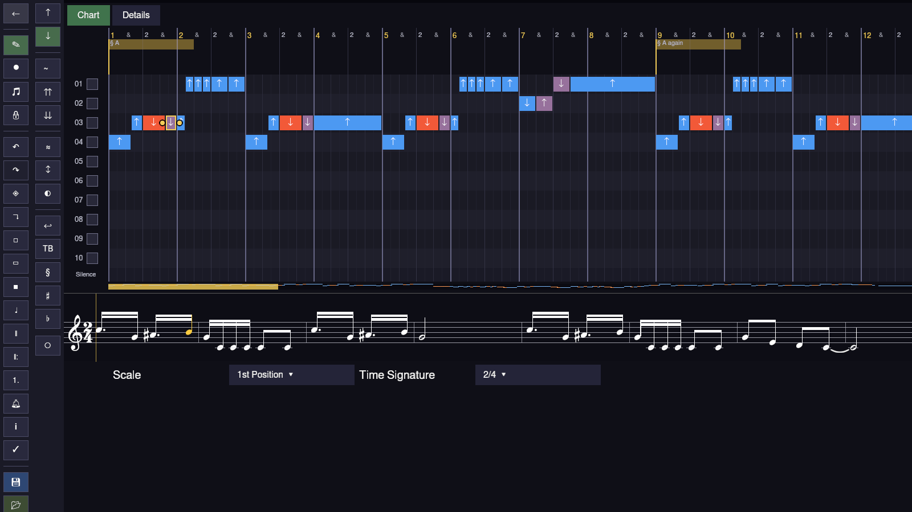
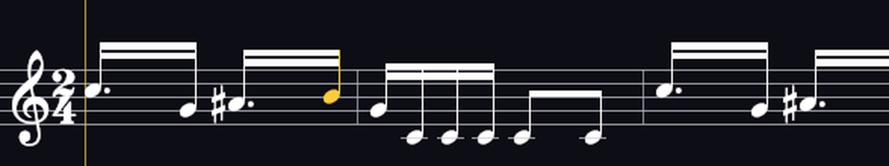
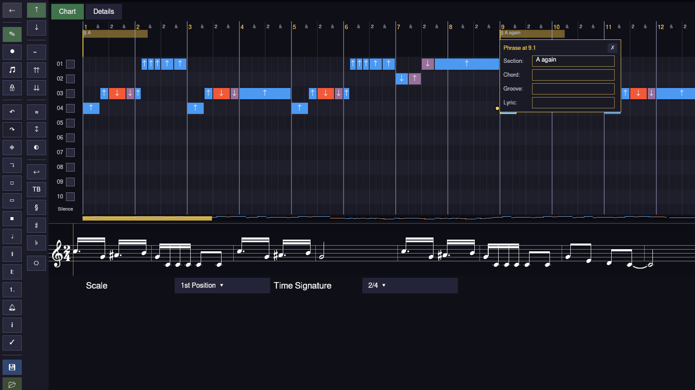
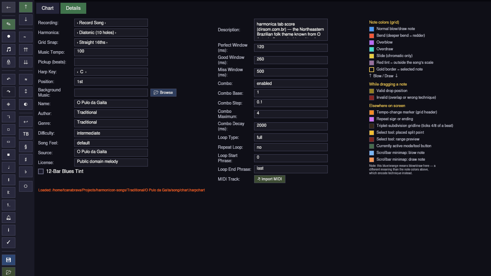

+++
title = "Harmonicon's song editor, explained with one song about a jumping harmonica"
date = 2026-10-04
description = "A walk around Harmonicon's song editor, with O Pulo da Gaita loaded in it, and a colour legend that knew better than I did."

[taxonomies]
tags=["rust", "bevy", "music", "harmonica", "gamedev"]
categories=["harmonicon"]
+++

This one is about the song editor. Harmonicon has a song editor, it's had one
for a while, I just never sat down and explained what all the little buttons
do, and there are a lot of little buttons. The game says four hundred and
thirty one, but most of those are notes pretending to be buttons, so it's less
than that.

So I'm going to load a song into it and walk around the screen.

## The song

The song is O Pulo da Gaita, or "The harmonica's jump" in english.
It's a folk theme from the Northeast of Brazil, people know it from "O Auto da
Compadecida", and the Northeast is where I'm from, Salvador, so I'm a bit
biased.

It's a good song to show the editor with because it's busy without being
hard. Two hundred and thirty nine notes in a bit over a minute, on a C
diatonic, in 2/4, at 100 bpm, and eighteen of those notes are bends. And the
whole tune hangs on one move: you bend the 3 draw down half a step and then let
it go, back up to the plain B. Bend, release. Remember that, it comes back.

## The whole screen

There are three things on this screen, and once you know that it stops being
four hundred and thirty one things.

**Down the left** there's the sidebar, which is two columns. The left column is
about the song and the tools: going back, the Edit / Record / Play modes, the
lock, undo and redo, copy and paste, the tools for selecting and erasing ranges
of time, tempo and meter changes, repeats and endings, the metronome, the
legend, save and load. The right column is about *the note*. The one you have
selected, or if you have nothing selected, the next one you're going to place.
Blow or draw, bend, overblow, overdraw, wah, vibrato and how deep, call and
response, split, the phrase editor, delete. So the left column is "what am I
doing" and the right column is "to which note".

**In the middle** is the grid. One lane per hole, ten of them because it's a
ten hole harmonica, numbered down the side. Time goes left to right, and along
the top there's the ruler, counting bars and beats. This song is in 2/4, so
the ruler goes "1 & 2 &" and then starts a new bar. Every note is a little
block on the lane of the hole you play it on, with an arrow on it, up for blow,
down for draw.

Under the last lane there's a thin strip that says Silence, which shows the gaps
between notes so you can spot a rest you didn't mean. And under *that* there's a
scrollbar that's also a tiny map of the whole song, every note drawn as a
coloured speck, with a gold bit showing where you're looking right now. In this
screenshot the gold bit is about a fifth of the way along, so the song is
roughly five screens long.

**Along the bottom** is a music staff, the same notes as sheet music. It
follows the grid when you scroll, so you can read it as a harmonica player
(holes and arrows) or as a musician (dots on lines), or both.

## Colours, and how I got them wrong

Now look at hole 3 in that first screenshot. There's a blue one, then an orange
one, then a sort of mauve one, and then another blue. And I looked at that and
I thought, the mauve one is the bend, and I wrote a paragraph about it.

Then I opened the Details tab, which has the colour legend in it, and the
legend said: orange is the bend. Deeper bends get redder. And the mauve isn't a
technique at all, it's a red *tint*, and it means "this note is outside the
song's scale".

So that's the bend and the release, right there. The orange one is the 3 draw
bent down half a step. The mauve one is the 3 draw let go, back up to B, and B
gets the tint because the editor is checking every note against a blues scale
on C, and there's no B in it. It's not an error, it's just the editor pointing
it out. The tune does it on purpose, fifteen times, I counted: fifteen bends on
the 3 draw, fifteen releases. The other three bends, to make up the eighteen,
are on the 2 draw, down at the end, where the song answers itself.

And the same two notes show up again in bar 3. And again later. Bend, release.

## Picking a note

In that close-up I've got the mauve one selected. A selected note gets a gold
border and two little round handles, one on each end, and you drag those to
make the note longer or shorter. Drag the middle of it and it moves. Click it
and you hear it, the editor plays a short blip of exactly that note, bend and
all, so you can check a bend sounds like a bend without picking up the
harmonica.

The other thing selecting does is it goes and finds the note on the staff and
paints it gold too, so you can see where you are in the actual music. And the
right column of the sidebar lights up Draw, because that's what the note is.
Click Blow and it would turn into a blow note.

## Phrases

Up in the header, above the lanes, there are these gold labels, "§ A" at the
start and "§ A again" at bar 9. Those are phrase markers, and you can click one
and it opens a little panel right there.

Section is the name of the bit of the song. Chord is the chord under it, if you
want the player to know. Groove is how it should feel, something like "laid
back", in words, for humans. And Lyric is the syllable that's sung when those
notes start, which then shows up karaoke style during the game. This chart
doesn't have chords or lyrics filled in yet, which is why those three boxes are
empty.

## Details

The other tab is Details, and it's where the song keeps its paperwork.

On the left there's everything about the song itself: the harmonica type, the
key (C), the position (1st), the tempo (100), the grid snap, who wrote it
(Traditional), the genre, the difficulty, where the transcription came from,
and the licence. In the middle there's how strict the game is when it scores
you: how many milliseconds count as perfect, as good, as a miss, how the combo
multiplier works, and which phrases loop. And on the right is the legend, which
I should have read first.

The status line at the bottom says where the chart was loaded from.

So that's the editor. Three parts, two tabs, one legend, and a song that bends
the 3 draw and lets it go, and bends it and lets it go. You can play it, it's in
the song pack, and it's on [GitHub](https://github.com/tcanabrava/harmonicon)
with everything else.

Bend, release.
