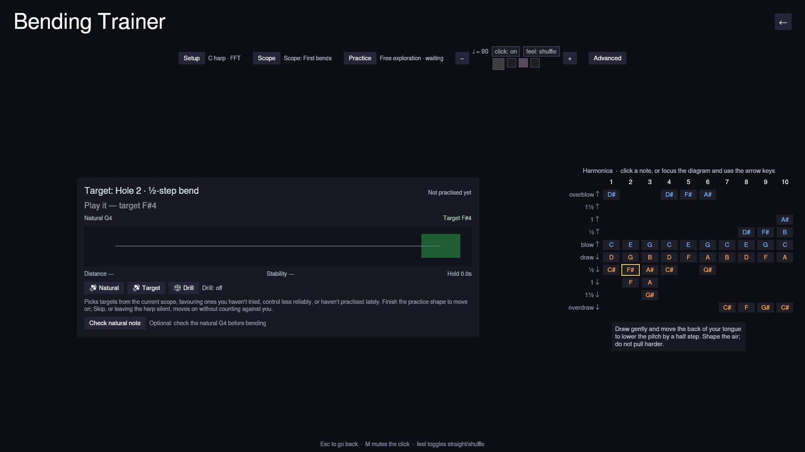
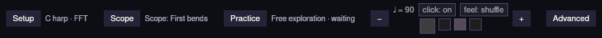
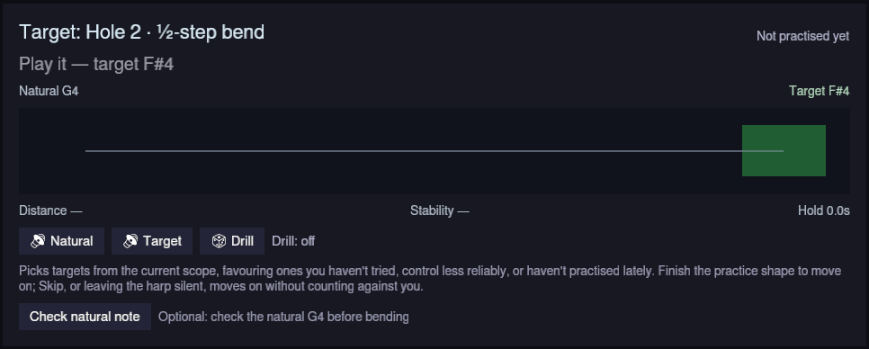
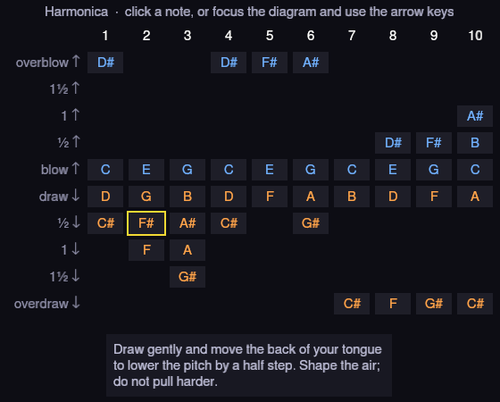

+++
title = "Harmonicon's bending trainer"
date = 2026-10-18
description = "A short tour of Harmonicon's bending trainer: one hole, one bend, and a live picture of your pitch."

[taxonomies]
tags=["rust", "bevy", "music", "harmonica", "gamedev"]
categories=["harmonicon"]
+++

Bending is the hardest thing to learn on a harmonica, mostly because you can't
see it. You change the shape of your mouth and throat, and the only feedback is
whether the note sounds right, which is exactly what a beginner can't judge yet.

The bending trainer is the screen in Harmonicon for practising that, one bend at
a time. There's no song and no score. You pick a hole, play, and see where your
pitch goes.

The screen has three parts: a settings strip at the top, the target card in the
middle, and the harmonica diagram on the right.

## Settings

**Setup** picks the harmonica key and the pitch detector (here, "C harp · FFT").
**Scope** and **Practice** control the drill, covered below. Then there's a
metronome with tempo, click and straight/shuffle feel, and **Advanced**.

Setup and Advanced open as floating panels, so the pitch display doesn't move
while you're using it.

## The target card

The card shows the current target, here hole 2 draw bent a half step, and how
it has gone for you so far.

The line under the title only reports on the selected hole. Silence, the wrong
hole and an unstable signal each get their own message. You only get a cents
reading when you're actually near the target.

The rail runs from the natural note (G4) to the target band (F#4). While you
play, a marker shows your pitch and a trail of dots shows the last few seconds,
so you can see whether you slid in smoothly, scooped, overshot or held still.
On holes with several bend depths, the shallower ones are marked along the way.

Below the rail are three separate numbers: distance from the target, stability,
and how long you've held it.

**Natural** and **Target** play both notes as reference tones. **Check natural
note** is optional: play the hole unbent and the trainer measures where that
reed really sits on your harmonica, then judges the hole against that instead of
the textbook value.

## The diagram

The diagram shows every note the harmonica can make, by hole and technique.
Blue notes are blown and orange notes are drawn, so overblows are blue even
though they sound above the draw note.

Click a cell (or use Tab, the arrow keys and Enter) to make it the target. A
hint for the selected bend appears underneath.

After some practice the diagram doubles as a progress map. Each cell is tinted
by how reliably you control that bend, with a bar along the bottom showing the
same thing, so it's readable without telling red from green.

## Practice and the drill

**Practice** sets what counts as one success:

- **Free exploration**: nothing, just play.
- **Find and hold**: reach the target and stay there.
- **Bend and release**: go down to the target and back to the natural note.
- **Repeated bends**: bend on the metronome beats.
- **Bend ladder**: step through each bend depth and back.
- **Overbend response**: attack and release an overblow or overdraw.

**Scope** sets which targets the drill uses: *First bends* (holes 2 and 3 draw,
the default), *All bends*, *Blow bends*, *Overbends*, or *Custom*, where you
click cells to add or remove them.

With **Drill** on, the trainer picks targets from that scope, favouring ones you
haven't tried, control less well, or haven't practised lately. It moves on when
you complete the practice shape. **Skip** moves on immediately, and silence
doesn't count against you: an attempt only counts once the microphone hears that
hole. Progress is saved between sessions.

## Advanced

Advanced sets the tolerance, hold time, attempt timeout, A4 reference, and how
much history and smoothing the rail uses. It also shows stats for the current
attempt: mean distance, spread, best hold, and vibrato speed and width.

The trainer only reports pitch. It doesn't claim anything about breath,
embouchure or reed health, because a microphone can't measure those.

Esc or the back arrow leaves the trainer, and drill progress is saved on the way
out. The code is on [GitHub](https://github.com/tcanabrava/harmonicon).
